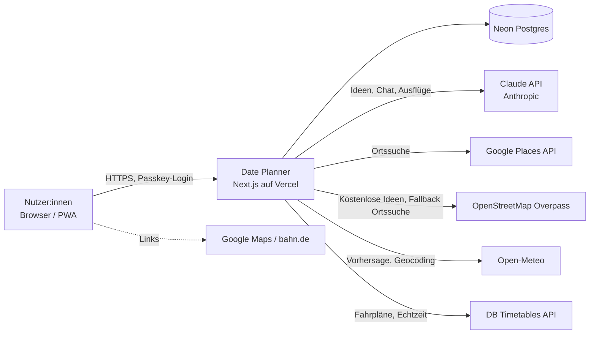

# 3. Kontextabgrenzung

| Partner                | Zweck                                         | Gesendete Daten                                                        | Kosten                                   |
| ---------------------- | --------------------------------------------- | ---------------------------------------------------------------------- | ---------------------------------------- |
| Claude API             | Aktivitäten generieren, Chat, Ausflugsplanung | Stadt/Region, Aktivitäten-Katalog, Planparameter, Chat-Text            | nutzungsabhängig, Limit 20 $/Monat       |
| Google Places          | Konkrete Orte, Öffnungszeiten, Bewertungen    | Suchbegriff + grobe Koordinaten                                        | Freikontingent, Quota-begrenzt           |
| OpenStreetMap Overpass | Ortssuche für kostenlose Ideen, Fallback      | Ortstyp + grobe Koordinaten                                            | kostenlos                                |
| Open-Meteo             | Wettervorhersage bis 16 Tage                  | grobe Koordinaten                                                      | kostenlos                                |
| Open-Meteo Geocoding   | Zielort („München“) in Koordinaten umwandeln  | eingegebener Ortsname                                                  | kostenlos, Quellenangabe GeoNames        |
| DB Timetables API      | Abfahrten/Ankünfte je Bahnhof mit Echtzeit    | Bahnhofsnummer, Datum/Stunde                                           | kostenlos (Free-Plan, 60/min), CC BY 4.0 |
| DB StaDa API           | Bahnhofsliste (einmalig per Skript)           | –                                                                      | kostenlos, CC BY 4.0                     |
| OpenStreetMap-Kacheln  | Kartenanzeige zur Wahl von Ort und Radius     | Kachelabrufe des Browsers (Kartenausschnitt um den gerundeten Wohnort) | kostenlos, Quellenangabe, Fair Use       |
| Google Maps / bahn.de  | Route/Verbindung öffnen                       | nur per Klick im Browser                                               | kostenlos                                |

**Datenschutz:** An Such- und Wetterdienste gehen nur Stadt bzw. auf ~1 km gerundete Koordinaten, nie eine Hausadresse. Route-Links (Google Maps) können den optionalen Wohnort-Pin enthalten; sie werden nur per Klick im Browser geöffnet (ADR-012).
