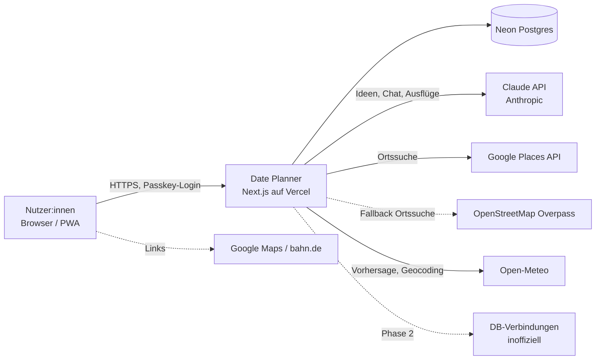

# 3. Kontextabgrenzung

| Partner                | Zweck                                         | Gesendete Daten                                             | Kosten                             |
| ---------------------- | --------------------------------------------- | ----------------------------------------------------------- | ---------------------------------- |
| Claude API             | Aktivitäten generieren, Chat, Ausflugsplanung | Stadt/Region, Aktivitäten-Katalog, Planparameter, Chat-Text | nutzungsabhängig, Limit 20 $/Monat |
| Google Places          | Konkrete Orte, Öffnungszeiten, Bewertungen    | Suchbegriff + grobe Koordinaten                             | Freikontingent, Quota-begrenzt     |
| OpenStreetMap Overpass | Fallback Ortssuche                            | Ortstyp + grobe Koordinaten                                 | kostenlos                          |
| Open-Meteo             | Wettervorhersage bis 16 Tage                  | grobe Koordinaten                                           | kostenlos                          |
| Open-Meteo Geocoding   | Zielort („München“) in Koordinaten umwandeln  | eingegebener Ortsname                                       | kostenlos, Quellenangabe GeoNames  |
| DB (Phase 2)           | Zugverbindungen, Regionalverkehr              | Start-/Zielbahnhof, Zeit                                    | kostenlos, inoffiziell             |
| Google Maps / bahn.de  | Route/Verbindung öffnen                       | nur per Klick im Browser                                    | kostenlos                          |

**Datenschutz:** An externe Dienste gehen nur Stadt bzw. auf PLZ-Gebiet gerundete Koordinaten, nie eine Hausadresse.
