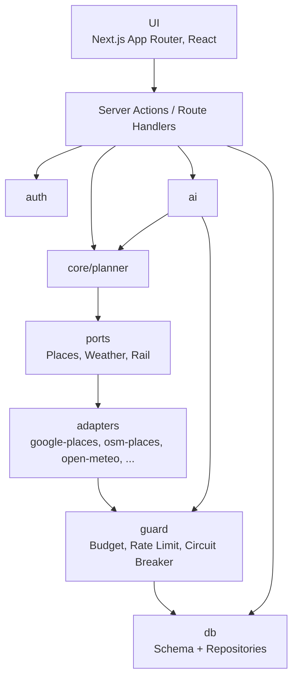

# 5. Bausteinsicht

## Ebene 1

| Baustein        | Verantwortung                                                                                                                                                                                                                                                                                                                                        | Abhängigkeiten                           |
| --------------- | ---------------------------------------------------------------------------------------------------------------------------------------------------------------------------------------------------------------------------------------------------------------------------------------------------------------------------------------------------- | ---------------------------------------- |
| `app/`          | Seiten, Formulare, Route Handlers                                                                                                                                                                                                                                                                                                                    | alle darunter                            |
| `auth/`         | Passkeys, Notfall-Passwort, Sessions, Login-Rate-Limit                                                                                                                                                                                                                                                                                               | `db`                                     |
| `core/planner/` | Filtern, Scoren, Ablauf bauen, aus Bewertungen lernen – **reine Logik ohne I/O**, vollständig unit-testbar. `build-plan.ts` steuert den Ablauf; `state.ts` (Planungszustand, Wege), `region.ts` (Suchgebiet), `venues.ts` (Ortssuche und Rangfolge), `schedule.ts` (Einplanen eines Punkts), `anchors.ts` (feste Programmpunkte)                     | nur `ports`, `lib`                       |
| `ports/`        | Schnittstellen externer Dienste (`PlacesProvider`, `WeatherProvider`, `RailTimetable`, `RailStationFinder`)                                                                                                                                                                                                                                          | –                                        |
| `adapters/`     | Implementierungen der Ports je Anbieter; gemeinsam `http.ts` (JSON-Abruf mit Timeout, kleiner TTL-Cache)                                                                                                                                                                                                                                             | `guard`, `lib`, `fetch`                  |
| `ai/`           | Claude-Anbindung: Client mit Frist je Anfrage, Ideen generieren, Chat-Tool-Loop, Ausflugsplanung, Prompt-Export/Import                                                                                                                                                                                                                               | `guard`, `core/planner`                  |
| `guard/`        | Budget-Wächter, Rate Limit, Circuit Breaker für alle kostenpflichtigen Aufrufe                                                                                                                                                                                                                                                                       | `db`                                     |
| `db/`           | Drizzle-Schema, Migrationen, Zugriff auf die Einstellungen (`settings.ts`)                                                                                                                                                                                                                                                                           | Neon Postgres                            |
| `planner/`      | Server-Service: Planung (`service.ts`), gespeicherte Pläne (`saved.ts`), Bearbeiten und Plan again (`edit.ts`), Züge und Wetter gespeicherter Pläne auffrischen (`refresh.ts`), Live-Status des nächsten Zugs (`live.ts`), Prüfschemas für Pläne vom Client (`schemas.ts`), Anzeigeformat (`view.ts`), Auswahl selbst gewählter Punkte (`chosen.ts`) | `core/planner`, `rail`, `adapters`, `db` |
| `admin/`        | Einstellungen (Wohnort per Geocoding, gerundet; optionaler Wohnort-Pin), Anreise-Routinen, Aktivitäten-Verwaltung, Ideen (Claude / Prompt-Export / JSON-Import), Verbrauchsübersicht                                                                                                                                                                 | `ai`, `adapters`, `db`, `guard`          |
| `chat/`         | Claude-Chat: Werkzeuge mit echten Daten verbinden (Plan erstellen, Wetter, Ideen suchen/speichern, Pläne auflisten), Verlauf (nur Text)                                                                                                                                                                                                              | `ai`, `planner`, `db`                    |
| `trips/`        | Mehrtägige Ausflüge: Claude mit Websuche, Ergebnis über Abschluss-Werkzeug mit festem Schema, Direktzüge für Hin- und Rückfahrt, Speicherung                                                                                                                                                                                                         | `ai`, `rail`, `adapters`, `db`           |
| `rail/`         | Zugverbindungen: Direktzüge und ein Umstieg aus Abfahrts-/Ankunftstafeln (`connection.ts`), voraussichtliche Züge aus einem ähnlichen Tag (`expected.ts`), Bahnhofsliste (`stations.json`, erzeugt per `npm run rail:stations`) – reine Algorithmen                                                                                                  | `ports`, `core/planner`, `lib`           |
| `ratings/`      | Bewertungen speichern, „We didn't go“, Hinweis auf der Startseite, Wetter vergangener Dates festhalten; liefert dem Planner die gelernten Werte                                                                                                                                                                                                      | `core/planner`, `adapters`, `db`         |
| `lib/`          | Zeitzonen-Hilfen und Anzeigeformate (Europe/Berlin), Dauern, Sonnenstand, Bahnhofsnamen vergleichen, `Result`-Typ und datensparsames Fehler-Logging                                                                                                                                                                                                  | –                                        |

Regel: `core/`, `rail/` und `lib/` importieren nie aus `adapters/`, `ai/`, `db/` oder `planner/`. Adapter werden über eine zentrale Factory anhand der Environment-Variablen ausgewählt.

## Datenmodell

| Tabelle                               | Inhalt                                                                                                                                                                                                                                                                                             |
| ------------------------------------- | -------------------------------------------------------------------------------------------------------------------------------------------------------------------------------------------------------------------------------------------------------------------------------------------------- |
| `settings`                            | Wohnort (Name, PLZ, gerundete Koordinaten, optionaler exakter Pin), Standard-Verkehrsmittel, Standard-Budget, max. Umkreis                                                                                                                                                                         |
| `travel_routine`                      | Anreise-Routinen, z. B. „Zug: Auto zum Bf. Rosenheim 15 min + 5 min Puffer“                                                                                                                                                                                                                        |
| `activity`                            | Titel (eindeutig, ohne Groß-/Kleinschreibung), Beschreibung, Kategorie, Tags, Kostenspanne, Dauer, Wetteranforderung, Verkehrsmittel, Ortstyp (z. B. `miniature_golf`) oder „zu Hause“, Tageszeit/Saison, Vorbereitung, Status (`draft`/`active`/`blocked`), Herkunft (`manual`/`claude`/`import`) |
| `date_plan`                           | Zeitfenster, Parameter, Wetter-Snapshot, Wetterpunkt (~10 km gerundet), Gesamtkosten, Mehrbetrag, Status (`accepted`), Favorit, Notiz, Zielort, Rückweg, Bewertung, „nicht stattgefunden“, Bewertungshinweis übersprungen, letzte Zugprüfung                                                       |
| `plan_item`                           | Programmpunkte mit Uhrzeit, Slot, Aktivität, Ort (Place-ID + Name dauerhaft; volle Ortsdaten + Alternativen bis zum Datum), Kosten, Anreise (inkl. Züge), Bewertung, „lag am Ort“, Wetterlage während des Punkts                                                                                   |
| `suggestion_log`                      | Wann welche Aktivität vorgeschlagen/angenommen wurde (Basis Abwechslung)                                                                                                                                                                                                                           |
| `api_usage`                           | Verbrauch je Anbieter und Tag (Anfragen, Tokens, geschätzte Kosten)                                                                                                                                                                                                                                |
| `chat_message`                        | Chat-Verlauf (nur Text, keine Ortsdaten)                                                                                                                                                                                                                                                           |
| `passkey`, `session`, `login_attempt` | Authentifizierung; eine Session kennt den Passkey, mit dem sie begonnen wurde                                                                                                                                                                                                                      |
| `trip`                                | Mehrtägige Ausflugsvorschläge (Eingabe, strukturierter Plan, Favorit)                                                                                                                                                                                                                              |
