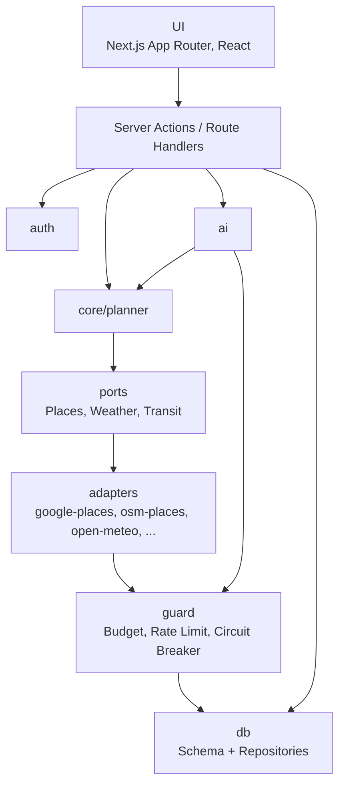

# 5. Bausteinsicht

## Ebene 1

| Baustein        | Verantwortung                                                                             | Abhängigkeiten           |
| --------------- | ----------------------------------------------------------------------------------------- | ------------------------ |
| `app/`          | Seiten, Formulare, Route Handlers                                                         | alle darunter            |
| `auth/`         | Passkeys, Notfall-Passwort, Sessions, Login-Rate-Limit                                    | `db`                     |
| `core/planner/` | Filtern, Scoren, Ablauf bauen – **reine Logik ohne I/O**, vollständig unit-testbar        | nur `ports` (Interfaces) |
| `ports/`        | Schnittstellen externer Dienste (`PlacesProvider`, `WeatherProvider`, `TransitProvider`)  | –                        |
| `adapters/`     | Implementierungen der Ports je Anbieter                                                   | `guard`, `fetch`         |
| `ai/`           | Claude-Anbindung: Ideen generieren, Chat-Tool-Loop, Ausflugsplanung, Prompt-Export/Import | `guard`, `core/planner`  |
| `guard/`        | Budget-Wächter, Rate Limit, Circuit Breaker für alle kostenpflichtigen Aufrufe            | `db`                     |
| `db/`           | Drizzle-Schema, Migrationen, Repositories                                                 | Neon Postgres            |

Regel: `core/` importiert nie aus `adapters/`, `ai/` oder `db/`. Adapter werden über eine zentrale Factory anhand der Environment-Variablen ausgewählt.

## Datenmodell (MVP)

| Tabelle                               | Inhalt                                                                                                                                                                                                                                                     |
| ------------------------------------- | ---------------------------------------------------------------------------------------------------------------------------------------------------------------------------------------------------------------------------------------------------------- |
| `settings`                            | Wohnort (Name, PLZ, gerundete Koordinaten), Standard-Verkehrsmittel, Standard-Budget, max. Umkreis                                                                                                                                                         |
| `travel_routine`                      | Anreise-Routinen, z. B. „Zug: Auto zum Bf. Rosenheim 15 min + 5 min Puffer“                                                                                                                                                                                |
| `activity`                            | Titel, Beschreibung, Kategorie, Tags, Kostenspanne, Dauer, Wetteranforderung, Verkehrsmittel, Ortstyp (z. B. `miniature_golf`) oder „zu Hause“, Tageszeit/Saison, Vorbereitung, Status (`draft`/`active`/`blocked`), Herkunft (`manual`/`claude`/`import`) |
| `date_plan`                           | Zeitfenster, Parameter, Wetter-Snapshot, Gesamtkosten, Status (`suggested`/`accepted`/`done`)                                                                                                                                                              |
| `plan_item`                           | Programmpunkte mit Uhrzeit, Aktivität, Ort (Place-ID + Anzeigename), Kosten, Anreise                                                                                                                                                                       |
| `suggestion_log`                      | Wann welche Aktivität vorgeschlagen/angenommen wurde (Basis Abwechslung)                                                                                                                                                                                   |
| `api_usage`                           | Verbrauch je Anbieter und Tag (Anfragen, Tokens, geschätzte Kosten)                                                                                                                                                                                        |
| `chat_message`                        | Chat-Verlauf                                                                                                                                                                                                                                               |
| `passkey`, `session`, `login_attempt` | Authentifizierung                                                                                                                                                                                                                                          |
| `rating` _(Phase 2)_                  | Sterne, „nochmal?“, Gründe                                                                                                                                                                                                                                 |
