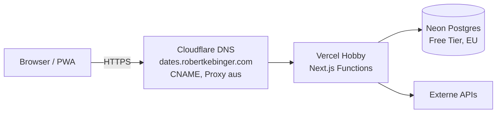

# 7. Verteilungssicht

| Element    | Konfiguration                                                                                  |
| ---------- | ---------------------------------------------------------------------------------------------- |
| Vercel     | Hobby-Plan, Region Frankfurt (`fra1`), Environment-Variablen für Secrets und Limits            |
| Neon       | Free Tier, Region EU (Frankfurt), Verbindung per Pooled Connection String                      |
| Cloudflare | Nur DNS; Proxy aus, damit Vercel Zertifikat und Caching verwaltet                              |
| Secrets    | Ausschließlich als Vercel Environment Variables; lokal in `.env.local` (nicht im Repo)         |
| Laufzeit   | `maxDuration`: Chat/Ideen 120 s, Ausflüge 300 s (Grenze Hobby-Plan); Region über `vercel.json` |

Schritt-für-Schritt: [Deployment](../betrieb/deployment.md). Kostenlimits und Kontingente der Anbieter: [Runbook Kostenlimits](../betrieb/kostenlimits.md).
